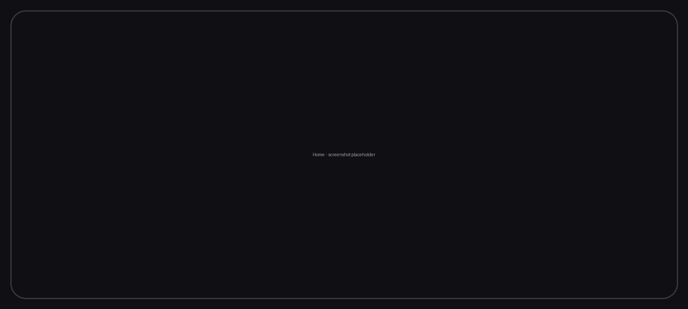
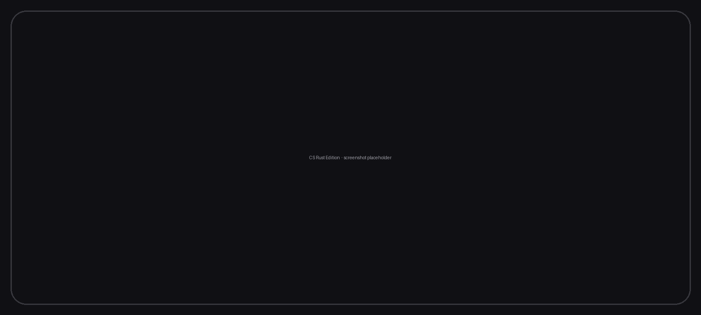
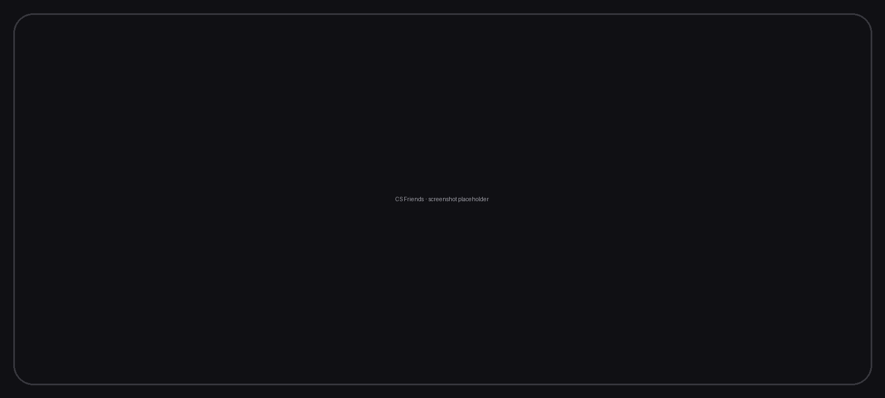
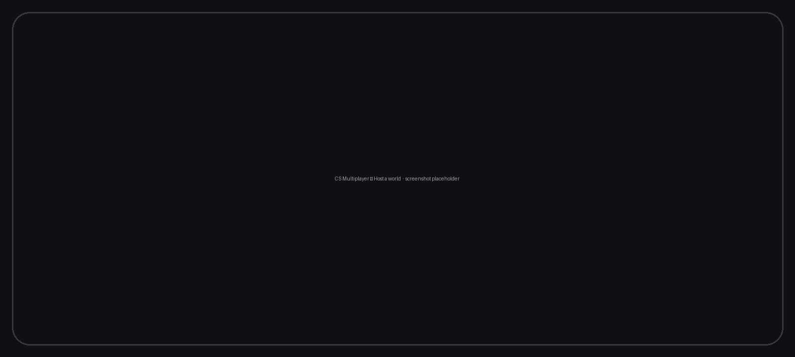

# CS Launcher Plus

**Minecraft: Java Edition on Android — fast, modern, and now with two engines.**

by CRAFT STUDIO

 

&nbsp;

&nbsp;

&nbsp;

  

&nbsp;

&nbsp;

&nbsp;

  

---

## What is CS Launcher Plus?

CS Launcher Plus lets you play **Minecraft: Java Edition** on your Android phone or tablet — every
version from the earliest alphas to the newest **26.x** snapshots, with Forge, Fabric, NeoForge, Quilt,
OptiFine, shaders, resource packs and modpacks from Modrinth and CurseForge.

Version **1.6** is the biggest update so far: a second game engine written in Rust, a built-in friends
system, one-tap multiplayer hosting and voice chat — all inside the launcher you already know.

> You need your own Minecraft: Java Edition account to play online. CS Launcher Plus is not affiliated
> with Mojang Studios or Microsoft and ships none of their code or assets.

---

## What's new in 1.6

### CS Rust Edition — a second engine

**CS Rust Edition** (shown in the app as **CS Engine — Powered by Craft Studio**) is a complete Minecraft
Java 26.3 client rewritten in Rust and rendered with Vulkan. No Java runtime, no translation layers,
far less memory — it starts in seconds and runs smoothly on phones that struggle with the Java engine.

- Pick it when you create a profile: **Java engine** or **CS Rust Edition**, side by side.
- Same CS controls, cursor, keyboard and settings in both engines.
- Sandboxed `.hmod` mods, shaders and resource packs, a built-in mod browser.
- Craft Studio title screen, loading screen and in-game menu with your 3D skin.
- Android 9+ · 64-bit (arm64). Source: [craftstudioteam/cs-rust-edition-](https://github.com/craftstudioteam/cs-rust-edition-) (MIT).

### CS Friends

A friends system that lives in the launcher **and** in the game.

- Create a free CS username and password (only needed for friends; a local account is enough to play).
- Friend requests, online status, direct messages and a notification bell next to your account.
- **Invites that work**: a friend hosts a world, you get a 🟢 *Join World* card, tap, and the launcher
  installs the right version, starts the game and joins automatically.
- Skin sharing between friends; chat bubbles above players in CS Rust Edition.
- The launcher and the engine each have their own friends panel with the same features.

### CS Multiplayer — host from your phone

- **Host a world** with one tap. Your singleplayer world becomes a public server through the free
  **e4mc** relay — no port forwarding, no VPN, no PC.
- Works in both engines; host sees a guest list and can kick a guest.
- Join a friend's host straight from an invite, or share the address with anyone.
- Server icon for your hosted world; Discord Rich Presence shows the server you are on.

### Built-in Voice Chat

- Push-to-talk / open mic voice chat inside the game, no extra app.
- Password-protected **voice groups** with invites and per-player mute — the same model as
  Simple Voice Chat servers.

### Everything else in 1.6

| Area | What changed |
|:--|:--|
| **Renderers** | New **CSGE** renderer (Craft Studio Graphics Engine, a MobileGlues build with 26.3 shader fixes) next to Holy GL4ES, LTW, MobileGlues, Zink and Virgl. Per-renderer icons and a redesigned renderer picker. |
| **Cursor** | Your own in-game pointer: any image, click point, size — for both engines. |
| **Controls** | CS Control System on both engines; keybinds page; cursor behaves like PojavLauncher. |
| **Accounts** | Local accounts by default; Microsoft, Ely.by and custom Yggdrasil servers (authlib-injector) with one-field "Add auth server". Animated account creation, Steve as default skin, skin editor. |
| **Profiles** | New create-profile flow (engine choice, every loader version listed, Horizon install inside the same flow), edit profile with "Open folder", per-profile icons, home shortcuts that start the game directly. |
| **Content** | Mod/modpack/shader/resource-pack browser (Modrinth + CurseForge), OptiFine profiles, Thorium recommended-mod card, native mods pipeline for CS Rust Edition. |
| **Play** | "Downloading" only when something really downloads, rocket "Launching" animation, auto download + start, crash post-mortem with fixes. |
| **Play Time & Discord** | Redesigned Play Time page (both engines count). Discord Rich Presence: home, launching, menu, world, LAN or server with the profile's icon; link/unlink optional. |
| **Settings** | New Settings hub with uniform cards; redesigned sub-pages; Storage (scoped or default) front and centre; Updates → **Update to Pro**. |
| **Languages** | English, Hinglish, Hindi and ten more. |
| **Polish** | Premium dark design system, smooth animations everywhere, first-launch terms and tutorial, About page with full credits and licenses. |

---

## Screenshots

| Home | Create profile |
|:--:|:--:|
|  |  |

| Friends | Host a world |
|:--:|:--:|
|  |  |

| CS Rust Edition in game | Settings |
|:--:|:--:|
|  |  |

---

## Install

1. Download `CS-Launcher-Plus-release.apk` from the
   [latest release](https://github.com/craftstudioteam/CS-LAUNCHER-PLUS/releases/latest).
2. Allow installs from your browser / file manager if Android asks.
3. Open the launcher, accept the terms, add an account (local is fine) and press **PLAY**.

**Requirements**

| | Java engine | CS Rust Edition |
|:--|:--|:--|
| Android | 5.0+ | 9.0+ |
| CPU | arm64, arm32, x86_64 | arm64 |
| RAM | 2 GB (4 GB for mods / 1.17+) | 2 GB |
| Storage | ~1 GB + game files | ~300 MB + game files |

---

## Compatibility

- **Game versions:** rd-132211 → 26.x snapshots (Java engine); 26.3 (CS Rust Edition).
- **Mod loaders (Java engine):** Forge, NeoForge, Fabric, Quilt, OptiFine.
- **CS Rust Edition** runs sandboxed `.hmod` mods only — Fabric/Forge/NeoForge Java mods do **not** run on it.
- **Servers:** any Java Edition server; hosted worlds via e4mc. Third-party clients may be disallowed by
  some servers' rules — check before you join.

---

## Community

- **Discord:** <https://discord.gg/dmteYqZZyY> — support, Pro upgrade, announcements
- **YouTube:** <https://youtube.com/@craft-studio-official> — tutorials and showcases
- **Website:** <https://official.craftstudios.site>
- **Issues:** use the GitHub issue tracker of this repository; share logs with the in-app **Share log** button.

---

## License and credits

CS Launcher Plus is free software under the **GNU LGPL v3**, a fork of the
[PojavLauncher](https://github.com/PojavLauncherTeam/PojavLauncher) family
([Amethyst](https://github.com/AngelAuraMC/Amethyst-Android)).
**CS Rust Edition** is **MIT** licensed, derived from [Horizon](https://github.com/horizon-rust/horizon)
by Ludovic Marie and the Horizon contributors and [Horizon Android](https://github.com/Vasysik/horizon-android)
by Vasysik; Craft Studio's changes are published under the same license at
[craftstudioteam/cs-rust-edition-](https://github.com/craftstudioteam/cs-rust-edition-).

Every bundled component, author and license is listed in the app under **About › Legal › Open source
notices**, and in `NOTICE` / `assets/licenses` in this repository. Highlights: OpenJDK (GPL-2.0+CE),
LWJGL (BSD-3), GLFW / SDL3 (zlib), Holy GL4ES, Mesa/Zink (MIT), LTW (LGPL-3), MobileGlues / CSGE (LGPL-2.1),
wgpu, winit, e4mc (MIT/Apache-2.0), authlib-injector (AGPL-3, separate program).

Minecraft is a trademark of Mojang Synergies AB / Microsoft. "Craft Studio", "CS Launcher Plus",
"CS Engine" and "CS Rust Edition" are Craft Studio's. Privacy policy: in the app (About › Privacy
policy) and in `PRIVACY_POLICY_en` / `PRIVACY_POLICY_hi`.

 
Made with ❤ by CRAFT STUDIO and the open source community.

